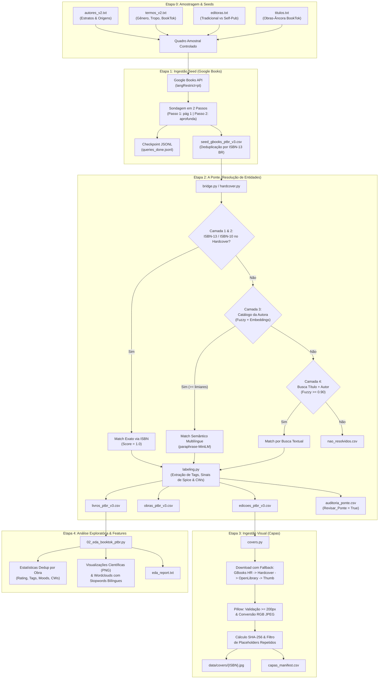
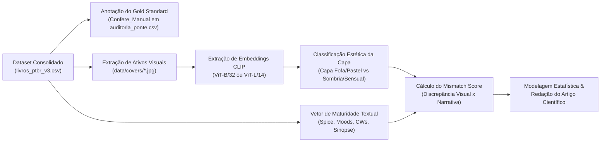

# Arquitetura, Engenharia de Dados e Resolução de Entidades: Pipeline BookTok Mismatch Analysis

> **Documento Técnico de Engenharia de Dados & Pesquisa Acadêmica**  
> **Projeto:** BookTok Mismatch Analysis (PT-BR)  
> **Versão do Pipeline:** v3 (Consolidado Incremental)  
> **Status do Repositório:** POC I (Engenharia de Dados & Resolução de Entidades) concluída; Preparado para POC II (Modelagem Multimodal & Discrepância Visual-Textual).

---

## Sumário Executivo e Visão Geral da Pesquisa

O projeto **BookTok Mismatch Analysis** é uma infraestrutura de engenharia de dados projetada para dar suporte a uma investigação científica em humanidades digitais, ciência social computacional e processamento de linguagem natural / visão computacional.

### O Problema de Pesquisa: A Hipótese da Discrepância (*Mismatch*)
No ecossistema contemporâneo do mercado editorial — impulsionado fortemente pela comunidade literária do TikTok (**BookTok**) —, observou-se uma tendência de mercado expressiva: livros com alto teor de conteúdo adulto, erotismo (*spice*), temas sombrios (*dark romance*) e gatilhos severos (*content warnings*) vêm sendo frequentemente embalados comercialmente com **capas de estética fofa, cartunesca, ilustrada e em tons pastéis**, associadas historicamente à literatura infantojuvenil (*Young Adult* / *Middle Grade*).

Esse descompasso gera a **Hipótese da Discrepância (*Mismatch*)**:
$$\text{Score de Discrepância} = f(\text{Estética Visual da Capa}, \text{Maturidade Temática da Narrativa})$$

Onde uma obra pode apresentar:
1. **Capa Fofa / Cartunesca** $\times$ **Baixo Spice / Romance Leve** $\rightarrow$ *Concordante (Controle Negativo)*.
2. **Capa Sombria / Tradicional** $\times$ **Alto Spice / Dark Romance** $\rightarrow$ *Concordante*.
3. **Capa Fofa / Cartunesca** $\times$ **Alto Spice / Temas Explícitos** $\rightarrow$ ***Discrepante (Alvo Principal do Fenômeno)***.

### Desafio Central de Engenharia de Dados
Para analisar quantitativamente e de forma reprodutível esse fenômeno no mercado brasileiro, deparou-se com um desafio clássico de **Record Linkage / Resolução de Entidades Bibliográficas**:
* O mercado nacional consome livros físicos e e-books em **Português do Brasil (PT-BR)**, catalogados com ISBNs nacionais (prefixos `978-85` e `978-65`), títulos traduzidos e editoras locais.
* No entanto, as bases com **folksonomia rica e granular** (marcações comunitárias de *spice*, *moods*, *content warnings* e *tropes*) são globais e anglófonas (em especial a plataforma **Hardcover**), onde as obras estão catalogadas pelo seu título original em inglês e pelos ISBNs das edições norte-americanas/britânicas.

Este pipeline resolve essa assimetria construindo uma **ponte determinística e probabilística** entre a **Edição Brasileira** (manifestação) e a **Obra Intelectual** (entidade abstrata global), preparando o *dataset* multimodal para extração de *embeddings* visuais (via CLIP) e textuais.

---

## 1. Topologia do Repositório: Componentes, Necessidade e Utilidade

A árvore de diretórios foi estruturada segundo princípios de modularidade, separação de preocupações (*SoC*) e garantia de reprodutibilidade científica:

```
booktok-mismatch-analysis/
├── requirements.txt                 # Dependências essenciais do pipeline (Core + EDA)
├── requirements-embeddings.txt      # Dependência opcional de Sentence Transformers
├── .env                             # Segredos locais e chaves de API (tokens)
├── .env.example                     # Modelo documentado de variáveis de ambiente
├── scripts/
│   ├── run.py                       # Orquestrador central (CLI unificado)
│   ├── ptbr_common.py               # Biblioteca core de normalização e regras de negócio
│   ├── 02_eda_booktok_ptbr.py       # Pipeline de Análise Exploratória e Engenharia de Features
│   └── pipeline_ptbr/
│       ├── __init__.py              # Declaração do pacote Python
│       ├── config.py                # Hiperparâmetros, caminhos de I/O e setup de rede
│       ├── util.py                  # I/O atômico de arquivos e helpers estruturais
│       ├── gbooks.py                # Módulo de Ingestão: Google Books API (Seed)
│       ├── hardcover.py             # Cliente GraphQL Hardcover & Resolução de Entidades
│       ├── bridge.py                # Orquestrador da Ponte (Resolução, Cache e Junção)
│       ├── labeling.py              # Parser de Folksonomia, Tags e Extração de Sinais
│       ├── covers.py                # Ingestão Visual, Padronização e Fingerprinting de Capas
│       └── probes.py                # Ferramental de diagnóstico e introspecção de schema
├── data/
│   ├── seeds/                       # Parâmetros de entrada e estado de paginação do seed
│   ├── cache/                       # Caches atômicos da ponte (persistência local)
│   ├── covers/                      # Armazenamento físico das capas (JPEGs normalizados)
│   └── processed/                   # Tabelas analíticas geradas pelo pipeline
└── outputs/                         # Gráficos, relatórios analíticos e logs de execução
```

### Detalhamento Arquitetural de Cada Arquivo

| Arquivo / Diretório | Necessidade no Projeto | Utilidade Técnica & Científica |
| :--- | :--- | :--- |
| `scripts/run.py` | Ponto de entrada unificado (*CLI Facade*). Evita que pesquisadores precisem rodar múltiplos scripts manuais em ordem incorreta. | Controla o fluxo `seed -> ponte -> capas -> eda`, gerencia argumentos de linha de comando (`--teste`, `--etapas`, `--retentar-falhas`) e garante injeção de parâmetros em tempo de execução. |
| `scripts/ptbr_common.py` | Elimina duplicação de regras de negócio entre o pipeline de dados e o script analítico de EDA. Depende estritamente da *stdlib*. | Contém as funções de normalização (`norm`), cálculo de similaridade fonética/léxica (`sim`), conversão bidirecional de ISBN-10/ISBN-13, higienização HTML e limpeza profunda de títulos via regex. |
| `scripts/pipeline_ptbr/config.py` | Centraliza caminhos absolutos, variáveis de ambiente e hiperparâmetros numéricos. | Elimina *hardcoded strings*, carrega o `.env` e aplica correção de nível de socket (`urllib3_cn.allowed_gai_family = AF_INET`) para evitar travamentos silenciosos de rede por IPv6 instável. |
| `scripts/pipeline_ptbr/util.py` | Garante integridade transacional dos dados em operações de disco. | Implementa sanitização de valores nulos (`v()`), leitura tolerante de tabelas de seeds com delimitador `pipe` (`\|`) e escrita atômica de JSONs via substituição de arquivo temporário (`.tmp -> replace`). |
| `scripts/pipeline_ptbr/gbooks.py` | Ingestão primária do mercado editorial em português. | Consulta a API v1 do Google Books através de 4 canais, gerencia cotas e rate limit (429), deduplica registros em tempo real e mantém estado de paginação persistente em JSONL. |
| `scripts/pipeline_ptbr/hardcover.py` | Comunicação com a base de conhecimento de folksonomia. | Cliente GraphQL para a API Hardcover. Contém a lógica de degradação graciosa de queries, extração de catálogo de autoras, cálculo de similaridade semântica por embeddings e busca de fallback. |
| `scripts/pipeline_ptbr/bridge.py` | Motor da Resolução de Entidades (*Record Linkage*). | Orquestra as etapas de resolução (ISBN $\rightarrow$ Catálogo $\rightarrow$ Busca), gerencia caches incrementais, monta as tabelas finais de Edições e Obras e extrai amostras de auditoria. |
| `scripts/pipeline_ptbr/labeling.py` | Engenharia de atributos (*Feature Engineering*) das marcações sociais. | Processa o JSON complexo de `cached_tags` do Hardcover, separa categorias (Genre, Mood, Tag, Content Warning), filtra ruídos e extrai flags booleanas e contagens de *Spice* e *Closed Door*. |
| `scripts/pipeline_ptbr/covers.py` | Ingestão e garantia de qualidade de ativos visuais para visão computacional. | Baixa imagens em ordem de prioridade de resolução, valida dimensões mínimas ($\ge 200\text{ px}$ para modelos ViT/CLIP), converte para RGB JPEG e calcula *hashes* SHA-256 para expurgar imagens de erro/placeholder. |
| `scripts/pipeline_ptbr/probes.py` | Diagnóstico de engenharia e inspeção de schemas GraphQL externos. | Realiza introspecção de tipos (`__type`) no Hardcover e roda consultas de viabilidade inversa (autora $\rightarrow$ edições brasileiras indexadas no Hardcover). |
| `scripts/02_eda_booktok_ptbr.py` | Análise Exploratória de Dados (EDA) e validação estatística. | Gera estatísticas descritivas, gráficos de distribuição, nuvens de palavras textuais, matrizes de frequência de tags e tabelas de contingência editoriais, separando rigorosamente a granularidade Edição vs. Obra. |
| `data/seeds/*.txt` | Definição da moldura amostral controlada da pesquisa. | Contém listas intencionais estratificadas de autoras (`autores_v2.txt`), termos de busca e tropos (`termos_v2.txt`), mapeamento tipológico de editoras (`editoras.txt`) e títulos-âncora (`titulos.txt`). |
| `data/cache/*.json` | Persistência do estado da ponte de resolução. | Caches de resolução de ISBN (`ponte_cache.json`), metadados de obras (`obras_cache.json`) e catálogos de autores (`catalogo_autora.json`), tornando o pipeline incremental e de baixo custo de requisições. |
| `data/processed/*.csv` | Camada analítica final (tabelas processadas). | Armazena as entidades canônicas do projeto (`edicoes_ptbr_v3.csv`, `obras_ptbr_v3.csv`, `livros_ptbr_v3.csv`), a fila de validação humana (`auditoria_ponte.csv`) e os registros não resolvidos. |

---

## 2. O Pipeline de Dados End-to-End

O pipeline opera como uma esteira direcionada acíclica (DAG) dividida em 5 etapas sequenciais, idempotentes e retomáveis:



---

## 3. Mergulho Profundo: Como o ISBN e as Entidades São Resolvidos

A resolução de registros bibliográficos entre o mercado brasileiro e a folksonomia global é o coração tecnológico deste projeto. 

### A Teoria Bibliográfica Subjacente: Modelo FRBR / IFLA LRM
O pipeline adota explicitamente a separação conceitual da norma biblioteconômica internacional **FRBR (Functional Requirements for Bibliographic Records)**:
* **Obra (*Work*)**: A criação intelectual abstrata (ex.: a narrativa de *Fourth Wing*, identificada pelo `Hardcover_Book_ID = 485897`).
* **Expressão (*Expression*)**: A tradução ou modificação da obra (ex.: a tradução para o Português Brasileiro, *Quarta Asa*).
* **Manifestação (*Manifestation*)**: A edição física, digital ou brochura publicada por uma editora específica (identificada pelo `ISBN_PT = 9788542819762`, publicada pela Editora Planeta).
* **Item (*Item*)**: O exemplar físico individual.

> [!IMPORTANT]
> **Por que uma consulta direta por ISBN falha na maioria das vezes?**  
> Plataformas comunitárias internacionais como Goodreads e Hardcover indexam primariamente ISBNs de países de língua inglesa (Estados Unidos, Reino Unido). Menos de 40% das edições brasileiras possuem seu ISBN registrado diretamente no Hardcover. Se o sistema dependesse exclusivamente do ISBN exato, mais de 60% dos dados seriam perdidos, introduzindo um **viés de seleção severo**.

---

### A Engenharia da Resolução em 7 Camadas

O módulo `hardcover.py` em conjunto com `ptbr_common.py` e `bridge.py` implementa uma arquitetura de resolução em cascata (*waterfall resolution*) com degradação controlada:

```
                  Entrada: Edição Brasileira (ISBN-13, Título PT, Autora, Editora)
                                                 │
                                                 ▼
        ┌────────────────────────────────────────────────────────────────────────────────┐
        │ Camada 1: Busca em Lote por ISBN-13 Exato no Hardcover (GraphQL `editions`)    │
        └──────────────────────────────────────┬─────────────────────────────────────────┘
                                               │ (Se não encontrou)
                                               ▼
        ┌────────────────────────────────────────────────────────────────────────────────┐
        │ Camada 2: Conversão Aritmética para ISBN-10 & Consulta no Hardcover            │
        └──────────────────────────────────────┬─────────────────────────────────────────┘
                                               │ (Se não encontrou)
                                               ▼
        ┌────────────────────────────────────────────────────────────────────────────────┐
        │ Camada 3: Sanitização Determinística do Título PT (`limpar_titulo`)            │
        │ - Expurgos de marketing, edições especiais, números de volume e ruído          │
        └──────────────────────────────────────┬─────────────────────────────────────────┘
                                               │
                                               ▼
        ┌────────────────────────────────────────────────────────────────────────────────┐
        │ Camada 4: Coleta e Cache do Catálogo Completo da Autora no Hardcover           │
        │ - Guarda estrita de autora: `autor_confere` (Sobrenome + Iniciais)             │
        └──────────────────────────────────────┬─────────────────────────────────────────┘
                                               │
                                               ▼
        ┌────────────────────────────────────────────────────────────────────────────────┐
        │ Camada 5: Resolução Híbrida no Catálogo (Léxica + Semântica Multilíngue)       │
        │ - Similaridade Léxica: SequenceMatcher (Score >= 0.90)                         │
        │ - Similaridade Neural: MiniLM-L12 Embeddings (Score >= 0.75 + Margem >= 0.08)  │
        └──────────────────────────────────────┬─────────────────────────────────────────┘
                                               │ (Se score insuficiente)
                                               ▼
        ┌────────────────────────────────────────────────────────────────────────────────┐
        │ Camada 6: Fallback de Busca Textual Direta (`search` Título Limpo + Autora)    │
        │ - Score Léxico >= 0.90 e Autora Estritamente Conferida                         │
        └──────────────────────────────────────┬─────────────────────────────────────────┘
                                               │
                         ┌─────────────────────┴─────────────────────┐
                         ▼ (Falha)                                   ▼ (Sucesso em qualquer camada)
               ┌───────────────────┐                       ┌───────────────────────────────────┐
               │ nao_resolvidos.csv│                       │ Obra Identificada (Book ID)       │
               └───────────────────┘                       └─────────────────┬─────────────────┘
                                                                             │
                                                                             ▼
                                                           ┌───────────────────────────────────┐
                                                           │ Camada 7: Auditoria Ativa         │
                                                           │ (Flag `Revisar_Ponte` se fallback)│
                                                           │ -> auditoria_ponte.csv            │
                                                           └───────────────────────────────────┘
```

#### Detalhes Matemáticos e Algorítmicos de Cada Camada:

#### 1. Camada 1: Match Direto por ISBN-13
* **Entrada:** ISBN-13 de 13 dígitos numéricos.
* **Mecanismo:** Consulta GraphQL em lotes de 25 edições:
  ```graphql
  query {
    editions(where: { isbn_13: { _in: ["9786559703722", ...] } }, limit: 100) {
      id isbn_13 isbn_10 title pages release_date book_id
      book {
        id title slug rating ratings_count release_year description users_count
        image { url }
        contributions { contribution author { name } }
        cached_tags
      }
    }
  }
  ```
* **Score Atribuído:** $1.0$ (`metodo = "isbn13_edicao"`). Confiança absoluta.

#### 2. Camada 2: Conversão Aritmética ISBN-13 $\leftrightarrow$ ISBN-10
Muitas edições cadastradas historicamente no Hardcover contêm apenas o campo `isbn_10`. O pipeline implementa a aritmética formal dos dígitos verificadores:
* **De ISBN-10 BR para ISBN-13:**  
  O grupo geográfico brasileiro no ISBN-10 é o prefixo `85`.  
  O radical torna-se $\text{radical} = "978" + \text{isbn10}[0..8]$.  
  O dígito verificador módulo 10 ponderado (pesos alternados 1 e 3) é calculado por:
  $$\text{check}_{13} = \left(10 - \left(\sum_{i=0}^{11} d_i \times (1 \text{ se } i \text{ par senão } 3)\right) \pmod{10}\right) \pmod{10}$$
* **De ISBN-13 para ISBN-10:**  
  Extrai-se o miolo $d = \text{isbn13}[3..11]$.  
  O dígito verificador módulo 11 ponderado (pesos decrescentes de 10 a 2) é calculado por:
  $$\text{soma} = \sum_{i=0}^{8} d_i \times (10 - i), \quad \text{resto} = 11 - (\text{soma} \pmod{11})$$
  $$\text{check}_{10} = \begin{cases} "0" & \text{se } \text{resto} = 11 \\ "X" & \text{se } \text{resto} = 10 \\ \text{str}(\text{resto}) & \text{caso contrário} \end{cases}$$
* **Score Atribuído:** $1.0$ (`metodo = "isbn10_edicao"`).

#### 3. Camada 3: Sanitização Determinística de Títulos (`limpar_titulo`)
Títulos brasileiros no Google Books frequentemente sofrem com poluição mercadológica extrema gerada pelas editoras.  
Exemplo real extraído da base:  
`"Meu Romeu sombrio – O dark romance de L.J. Shen e Parker S. Huntington é uma releitura moderna de Romeu e Julieta e A Bela e a Fera"` $\rightarrow$ Higienizado para: `"Meu Romeu sombrio"`.

O algoritmo em [ptbr_common.py](file:///home/gabriella/Documents/faculdade/ufmg/projeto_completo/booktok-mismatch-analysis/scripts/ptbr_common.py#L146-L187):
1. Avalia parênteses e colchetes com regex `RE_MARKETING` (remove tags como *(Romantasia sucesso no TikTok)*, *(Edição Especial)*, *(Livro 2)*).
2. Localiza separadores de subtítulo (`–`, `—`, `-`, `:`) e testa se a porção subsequente contém termos mercadológicos ou repetição do título original.
3. Remove numerais de volume finais (`vol. 1`, `livro 2`).
4. Preserva subtítulos legítimos que pertençam à obra literária.

#### 4. Camada 4: Coleta de Catálogo da Autora e Guarda Estrita (`autor_confere`)
Para evitar falsos positivos comuns em bases bibliográficas, o sistema implementa a função [autor_confere](file:///home/gabriella/Documents/faculdade/ufmg/projeto_completo/booktok-mismatch-analysis/scripts/ptbr_common.py#L123-L141):
* **Regra:** O sobrenome é obrigatório. O primeiro nome é obrigatório se for palavra completa; se for inicial, exige todas as iniciais.
* **Casos Críticos Resolvidos com Sucesso:**
  * Impede que `"Christina Lauren"` (pseudônimo duplo) case com livros de `"Lauren Asher"`.
  * Impede que `"A.C. Meyer"` case com `"Stephenie Meyer"`.
  * Aceita com segurança variações legítimas: `"Jennifer L. Armentrout"` $\leftrightarrow$ `"Jennifer Armentrout"`.
* O catálogo recuperado é persistido em `data/cache/catalogo_autora.json`, evitando requisições redundantes à API.

#### 5. Camada 5: Resolução Híbrida (Léxica + Embeddings Multilíngues)
No catálogo da autora, o título limpo em português é comparado contra o título original em inglês e todos os `alternative_titles` cadastrados no Hardcover.

* **Similaridade Léxica ($S_{\text{fuzzy}}$):**
  Calculada via `difflib.SequenceMatcher.ratio()` sobre strings sem acentos e em minúsculas:
  $$S_{\text{fuzzy}} = \frac{2 \cdot M}{|T_{\text{PT}}| + |T_{\text{HC}}|}$$
  Se $S_{\text{fuzzy}} \ge 0.90$ (`FUZZY_ACEITE`), a correspondência é aceita imediatamente (ex.: *"Indigo Ridge"* $\leftrightarrow$ *"Aconteceu em Indigo Ridge"*).

* **Similaridade Semântica Neural ($S_{\text{emb}}$):**
  Quando o livro é traduzido livremente, a similaridade léxica falha completamente (ex.: *"Quarta Asa"* vs *"Fourth Wing"* tem $S_{\text{fuzzy}} \approx 0.15$).  
  Para resolver isso, o pipeline emprega o modelo **`paraphrase-multilingual-MiniLM-L12-v2`** da biblioteca `sentence-transformers`:
  $$\vec{e}_{\text{PT}} = \text{Embedder}(T_{\text{PT}}), \quad \vec{e}_{\text{HC}} = \text{Embedder}(T_{\text{HC}})$$
  $$S_{\text{emb}} = \frac{\vec{e}_{\text{PT}} \cdot \vec{e}_{\text{HC}}}{\|\vec{e}_{\text{PT}}\| \|\vec{e}_{\text{HC}}\|}$$
  *Critérios de Aceitação Obrigatórios:*
  1. $S_{\text{emb}} \ge 0.75$ (`EMB_ACEITE`).
  2. **Teste da Margem de Confiança:** $\Delta_{\text{margem}} = S_{\text{emb}}^{\text{1º colocado}} - S_{\text{emb}}^{\text{2º colocado}} \ge 0.08$ (`EMB_MARGEM`).
  
  > [!TIP]
  > **Racional Científico da Margem:** Séries de livros da mesma autora costumam compartilhar vocabulário semântico idêntico (ex.: *A Court of Thorns and Roses*, *A Court of Mist and Fury*, *A Court of Wings and Ruin*). Sem a margem de 0.08, o modelo neural correria o risco de ligar a edição brasileira do Volume 2 à obra do Volume 1 devido à proximidade vetorial. A margem garante unicidade e separabilidade.

#### 6. Camada 6: Busca Textual no Hardcover (`ponte_por_busca`)
Caso a autora não tenha sido encontrada na etapa de catálogo (ex.: grafia com erro no Google Books), o pipeline executa uma consulta direta de busca com o termo concatenado `"{Titulo_Limpo} {Primeiro_Autor}"`, impondo validação estrita de $S_{\text{fuzzy}} \ge 0.90$ e confirmação de autoria via `autor_confere`.

#### 7. Camada 7: Protocolo de Auditoria Ativa (Gold Standard)
Nenhum algoritmo probabilístico é aceito às cegas. Todo registro onde:
* O método não foi por ISBN direto (`Revisar_Todo_Fallback = True`), OU
* O score de confiança ficou abaixo de $0.95$ (`REVISAR_ABAIXO`), OU
* O teste booleano independente `Autor_Confere` resultou em `False` (autor da edição brasileira ausente na obra do Hardcover).

É automaticamente marcado com `Revisar_Ponte = True` e exportado para `data/processed/auditoria_ponte.csv`. Esse arquivo possui a coluna vazia `Confere_Manual`, desenhada para permitir **auditoria humana cega (*Human-in-the-Loop*)**, possibilitando o cálculo formal das métricas de **Precisão, Recall e F1-Score** do algoritmo de ponte.

---

## 4. O Subsistema de Capas e Visão Computacional (`covers.py`)

O objetivo de longo prazo do projeto exige analisar as capas por meio de modelos Vision-Language (como **CLIP - ViT-B/32**). Para viabilizar essa etapa, a engenharia de dados do módulo `covers.py` implementou salvaguardas específicas:

1. **Persistência Local Imutável:** URLs públicas de imagens fornecidas pelo Google Books e CDNs do Hardcover expiram, sofrem rotação ou são bloqueadas por CORS/hotlink. Salvar fisicamente os arquivos em `data/covers/{ISBN}.jpg` assegura reprodutibilidade científica permanente.
2. **Cascata de Resolução de Imagens:**
   * Prioridade 1: `gbooks_hr` (URL direta de alta resolução do Google Books usando `zoom=3` no endpoint de conteúdo).
   * Prioridade 2: `hardcover_edicao` (CDN de alta definição do Hardcover).
   * Prioridade 3: `openlibrary` (API de capas da OpenLibrary via ISBN: `covers.openlibrary.org/b/isbn/{isbn}-L.jpg`).
   * Prioridade 4: `gbooks_thumb` (Thumbnail padrão `zoom=1`, ~128 px).
3. **Validação Dimensional e Sanitização de Formato:**
   * Utiliza a biblioteca `Pillow` para inspecionar a largura e altura reais da imagem.
   * Exige dimensão mínima de $\min(W, H) \ge 200\text{ px}$ para garantir que a rede neural convolucional/transformer não receba imagens excessivamente pixeladas.
   * Converte compulsoriamente imagens em paletas indexadas, CMYK ou RGBA para o espaço de cor **RGB padrão** e salva como JPEG com qualidade 95.
4. **Detecção Criptográfica de Imagens Placeholder:**
   * A API do Google Books frequentemente retorna HTTP 200 contendo uma imagem genérica padronizada com o texto *"Imagem de capa não disponível"*.
   * O pipeline gera o *hash* criptográfico **SHA-256** do binário de cada capa baixada.
   * Capas que compartilham o mesmo SHA-256 com frequência $\ge 3$ são automaticamente identificadas e sinalizadas no manifesto com `Placeholder_Suspeito = True`, evitando que imagens vazias contaminem o modelo preditivo de discrepância.
5. **Manifesto de Auditoria (`capas_manifest.csv`):**
   * Registra metadados forenses de cada arquivo: `ISBN_PT`, `Arquivo`, `Fonte`, `URL`, `Largura`, `Altura`, `Bytes`, `SHA256`, `Baixado_Em` e `Placeholder_Suspeito`.

---

## 5. Extração de Sinais, Tags e Engenharia de Atributos (`labeling.py` & `eda`)

No módulo `labeling.py`, os metadados agregados pelo Hardcover sob a chave `cached_tags` são descompactados e transformados em variáveis tabulares numéricas e booleanas.

### Sinais de Spice e Conteúdo Explícito
Para mensurar a maturidade da obra sem incorrer em subjetividade, o pipeline realiza a mineração de texto nos termos cadastrados pela comunidade:
* **Regex de Spice (`RE_SPICE`):**
  Identifica menções a termos como `steamy`, `spicy`, `explicit`, `open door`, `erotic`, `smut`, `sex scenes`, `graphic sex`, `high heat`.
* **Regex de Romance Sem Sexo / Fechado (`RE_CLOSED`):**
  Identifica o polo oposto: `closed door`, `fade to black`, `clean romance`, `sweet romance`, `no spice`, `low heat`, `no sex`.
* **Separação Ontológica de Content Warnings:**
  O pipeline separa formalmente a presença da tag comunitária de *spice* da **Content Warning (CW) de Conteúdo Sexual**:
  * *Spice Tag:* Avalia a intensidade estética/erótica do relacionamento romântico.
  * *CW Sexual Content:* Alerta sobre a existência de temas sexuais sensíveis (podendo incluir violência sexual, agressão ou conteúdo não consentido).
* **Parâmetro `min_count_spice`:**
  Uma tag só aciona uma *Flag* booleana se a contagem comunitária de votos no Hardcover for maior ou igual ao limiar configurado (padrão: 2 votos), filtrando marcações acidentais ou isoladas de usuários individuais.

### Desacoplamento da Unidade de Análise no EDA
No script [02_eda_booktok_ptbr.py](file:///home/gabriella/Documents/faculdade/ufmg/projeto_completo/booktok-mismatch-analysis/scripts/02_eda_booktok_ptbr.py#L138-L145), foi implementada uma diferenciação metodológica vital:
* **Atributos da Edição:** `Editora_PT`, `Ano_Publicacao_PT`, `Num_Paginas_PT`, `Capa_URL_PT`. A unidade amostral é a manifestação comercial no Brasil (ISBN).
* **Atributos da Obra:** `Rating`, `Generos`, `Moods`, `Tags_Gerais`, `Content_Warnings`, `Flags de Spice`. A unidade de análise é a obra intelectual (`Hardcover_Book_ID`).
* **Função `_por_obra(df)`:** Deduplica a base pelo identificador da obra para o cálculo de médias, histogramas e correlações de conteúdo. Sem essa salvaguarda, obras com 5 ou 6 reedições no Brasil teriam seu peso artificialmente inflado em 500% nas estatísticas descritivas globais.

---

## 6. Decisões Arquiteturais e Trade-Offs de Projeto

| Decisão de Projeto | Alternativa Descartada | Racional Técnico & Metodológico |
| :--- | :--- | :--- |
| **Pilha de APIs Híbrida: Google Books + Hardcover** | Goodreads API (descontinuada/privada), Amazon (scraping frágil e proibido por ToS) ou Skoob (sem API pública estruturada). | O Google Books possui cobertura exaustiva do catálogo brasileiro via ISBN. O Hardcover oferece uma API GraphQL moderna, estável e com categorização de folksonomia rica, aberta e com contagem ponderada de votos. |
| **Duplo Nível de Entidade: Edições vs. Obras** | Tabela única totalmente desnormalizada sem distinção conceitual. | Preserva a integridade relacional. Permite estudar a relação 1:N (uma obra mundial traduzida por diferentes editoras brasileiras em anos distintos com capas diferentes). |
| **Persistência Incremental e Caches Atômicos** | Banco relacional SQL pesado (PostgreSQL/MySQL) ou regravação direta de JSONs em memória. | O projeto precisava ser leve, portável e executável localmente sem dependências externas de infraestrutura. A gravação via arquivo `.tmp` seguida de `os.replace` garante escrita atômica (*ACID-like* no nível do sistema de arquivos), impedindo corrupção de cache por interrupção via `Ctrl+C`. |
| **Checkpoint em JSONL (`queries_done.jsonl`)** | Gravação de checkpoint dentro do próprio CSV de seed. | O formato JSONL append-only permite que cada requisição da API do Google Books salve seu estado instantaneamente com *flush* em disco sem precisar reescrever tabelas inteiras. |
| **Sondagem em Dois Passos no Seed** | Busca exaustiva de todas as páginas de todas as queries de uma só vez. | O Google Books possui cotas diárias estritas (limite de requisições). O Passo 1 consulta apenas a página 1 de todas as queries. Queries com zero rendimento de edições brasileiras são abortadas imediatamente, poupando centenas de requisições inúteis. |
| **Isolamento de Termos de Conteúdo no Seed** | Usar buscas por `"cenas explícitas"` ou `"conteúdo adulto"` como fonte primária sem marcação de procedência. | **Prevenção de Circularidade (Data Leakage):** Se o seed seleciona livros buscando termos de conteúdo adulto e depois o modelo usa esses livros para provar que o mercado tem conteúdo adulto, há viés de seleção confirmatório. O pipeline registra a procedência em `Tipos_Origem` permitindo rodar a análise analítica com e sem esses termos (*estrato de sensibilidade*). |
| **Amostragem Aleatória com Seed Fixo no `--limite`** | Seleção linear via `head(N)`. | Executar `head(30)` em testes pegaria apenas as edições das primeiras autoras da lista alfabética. O uso de `df.sample(n=limite, random_state=42)` garante uma amostra estratificada e reprodutível representativa de todos os gêneros do seed. |
| **Forçamento de Família de Socket IPv4** | Deixar a resolução padrão do sistema operacional (IPv6 preferencial). | Conexões IPv6 para endpoints de APIs de terceiros frequentemente sofrem *blackholing* silencioso ou latências que excedem timeouts de HTTP sem emitir exceção clara. `urllib3_cn.allowed_gai_family = lambda: socket.AF_INET` estabilizou a comunicação. |

---

## 7. Dicionário de Dados: Schemas das Tabelas Processadas

### 7.1. Tabela Principal Consolidada: `livros_ptbr_v3.csv`
Esta tabela é o *join* analítico final entre a Edição Brasileira e a Obra no Hardcover (`df_ed.merge(df_ob, on="Hardcover_Book_ID", how="left")`):

| Campo | Tipo | Origem | Descrição / Significado |
| :--- | :--- | :--- | :--- |
| `ISBN_PT` | `string` | Google Books | Identificador primário da edição brasileira (ISBN-13 numérico, prefixos 97885 ou 97865). |
| `Hardcover_Book_ID` | `integer` | Hardcover | Identificador canônico da Obra na base Hardcover. Chave estrangeira que unifica as edições. |
| `GB_ID` | `string` | Google Books | ID alfanumérico do volume no Google Books. |
| `Titulo_PT` | `string` | Google Books | Título da edição conforme cadastrado originalmente pela editora brasileira. |
| `Titulo_PT_Limpo` | `string` | Pipeline | Título da edição após higienização por regex (sem slogans de marketing, volumes ou subtítulos descartáveis). |
| `Autor_PT` | `string` | Google Books | Nomes dos autores informados no catálogo brasileiro. |
| `Editora_PT` | `string` | Google Books | Nome da editora brasileira (selo editorial). |
| `Tipo_Editorial_Editora` | `string` | Pipeline | Classificação da editora: `trad` (tradicional comercial), `trad_nicho` (selo especializado), `selfpub` (autopublicação/indie) ou `desconhecido`. |
| `Ano_Publicacao_PT` | `string` | Google Books | Data ou ano de publicação da edição no Brasil. |
| `Num_Paginas_PT` | `integer` | GBooks/HC | Contagem de páginas da edição física/digital brasileira. |
| `Capa_URL_PT` | `string` | Google Books | URL do thumbnail oficial do Google Books. |
| `Capa_URL_PT_HR` | `string` | Google Books | URL de alta resolução calculada (`zoom=3`). |
| `Sinopse_PT` | `string` | Google Books | Texto da sinopse brasileira com tags HTML e entidades devidamente decodificadas e removidas. |
| `Categorias_GB` | `string` | Google Books | Categorias fornecidas pelo Google Books (ex.: `Fiction`, `Young Adult Fiction`). |
| `Maturity_GB` | `string` | Google Books | Classificação etária fornecida pelo Google Books (`NOT_MATURE` ou `MATURE`). |
| `E_Ebook` | `boolean` | Google Books | Sinalizador de formato se o registro é e-book digital. |
| `Metodo_Ponte` | `string` | Pipeline | Estratégia vitoriosa na resolução: `isbn13_edicao`, `isbn10_edicao`, `catalogo_autora` ou `busca_titulo_autor`. |
| `Score_Ponte` | `float` | Pipeline | Score final de confiança da associação ($0.0$ a $1.0$). |
| `Score_Fuzzy` | `float` | Pipeline | Score obtido no casamento léxico fonético. |
| `Score_Emb` | `float` | Pipeline | Score de similaridade de cosseno obtido via Sentence Transformers. |
| `Autor_Confere` | `boolean` | Pipeline | Teste de sanidade independente: se o autor brasileiro consta na lista de autores da obra no Hardcover. |
| `Revisar_Ponte` | `boolean` | Pipeline | Flag de auditoria: `True` indica necessidade de conferência humana obrigatória no Gold Standard. |
| `Consultas_Origem` | `string` | Seed State | Proveniência: quais consultas do seed capturaram esta edição (separadas por pipe). |
| `Tipos_Origem` | `string` | Seed State | Proveniência de canal: ex.: `autora`, `termo:genero`, `termo:tropo`, `termo:conteudo`. |
| `Estratos_Origem` | `string` | Seed State | Covariável de estrato cadastrada na autora (ex.: `new_adult`, `dark`, `romcom`, `controle_ya`). |
| `Origens_Pais` | `string` | Seed State | País de origem da autora conforme seed (`EN` ou `BR`). |
| `Titulo_Original_EN` | `string` | Hardcover | Título original da obra literária (geralmente em inglês). |
| `Autor_Original_EN` | `string` | Hardcover | Autor principal da obra no Hardcover (filtrando tradutores e ilustradores). |
| `Autores_Hardcover` | `string` | Hardcover | Lista completa de autores canônicos associados à obra. |
| `Ano_Original_EN` | `integer` | Hardcover | Ano de lançamento original da obra. |
| `Avaliacao_Hardcover` | `float` | Hardcover | Nota média dos leitores no Hardcover (1.0 a 5.0). |
| `Qtd_Avaliacoes_Hardcover` | `integer` | Hardcover | Quantidade de avaliações recebidas pela obra. |
| `Qtd_Usuarios_Hardcover` | `integer` | Hardcover | Número de leitores que adicionaram a obra à sua estante no Hardcover. |
| `Capa_URL_Original_EN` | `string` | Hardcover | URL da capa da obra original global. |
| `Generos_Hardcover` | `string` | Hardcover | Gêneros literários comunitários (ex.: `Romance \| Fantasy \| Dark Romance`). |
| `Moods_Hardcover` | `string` | Hardcover | Ambientes emocionais atribuídos pelos leitores (ex.: `emotional \| funny \| dark`). |
| `Tags_Gerais_Hardcover` | `string` | Hardcover | Tropos e marcações gerais (ex.: `enemies to lovers \| forced proximity`). |
| `Content_Warnings` | `string` | Hardcover | Alertas de gatilho votados pela comunidade (ex.: `sexual content \| violence \| death`). |
| `Tags_JSON` | `json` | Hardcover | JSON serializado original preservando a contagem de votos (`count`) de cada tag. |
| `Spice_Tags` | `string` | Pipeline | Tags de *spice* identificadas seguidas de seus votos (ex.: `explicit:4 \| steamy:2`). |
| `Spice_Tags_Contagem` | `integer` | Pipeline | Soma total dos votos comunitários de *spice*. |
| `Flag_Spice_Tag` | `boolean` | Pipeline | `True` se houver tag de *spice* com contagem $\ge \text{min\_count\_spice}$. |
| `Closed_Door_Tags` | `string` | Pipeline | Tags de romance sem sexo explícito (ex.: `closed door \| sweet romance`). |
| `Flag_Closed_Door_Tag` | `boolean` | Pipeline | `True` se a obra for explicitamente identificada como *closed door*. |
| `Flag_CW_Sexual_Content`| `boolean` | Pipeline | `True` se constar o alerta de conteúdo sexual nos Content Warnings. |
| `CW_Sexual_Content_Contagem` | `integer` | Pipeline | Votos na Content Warning de conteúdo sexual. |
| `Flag_Romance` | `boolean` | Pipeline | Validador temático: confirma se a obra possui a marcação de Romance. |
| `Flag_New_Adult` | `boolean` | Pipeline | Validador temático: confirma marcação de literatura New Adult. |
| `Flag_Formato_Excluir` | `boolean` | Pipeline | Flag de expurgo: indica se a obra é mangá, quadrinho, graphic novel ou infantil. |
| `N_Edicoes_PT_no_Seed` | `integer` | Pipeline | Número de edições brasileiras distintas associadas a esta mesma obra na base. |

---

### 7.2. Tabela de Auditoria Ativa: `auditoria_ponte.csv`
Estruturada especificamente para validação humana cega:
* **Colunas:** `ISBN_PT`, `Titulo_PT`, `Autor_PT`, `Hardcover_Book_ID`, `Titulo_Original_EN`, `Autor_Original_EN`, `Autores_Hardcover`, `Autor_Confere`, `Metodo_Ponte`, `Score_Ponte`, `Score_Fuzzy`, `Score_Emb`, `Confere_Manual`.
* **Utilidade:** O pesquisador preenche a coluna `Confere_Manual` com `S` (Sim) ou `N` (Não). Isso gera uma matriz de confusão formal para reportar no artigo acadêmico a precisão exata da ponte de dados.

### 7.3. Tabela de Não Resolvidos: `nao_resolvidos.csv`
Armazena as edições brasileiras que não encontraram correspondência válida no Hardcover.  
* **Utilidade:** Diagnosticar lacunas de cobertura da base internacional (ex.: obras de autoras 100% nacionais de autopublicação que não possuem leitores internacionais cadastrando a obra no Hardcover).

### 7.4. Manifesto de Capas: `capas_manifest.csv`
Armazena a rastreabilidade e integridade de cada imagem:
* **Colunas:** `ISBN_PT`, `Arquivo`, `Fonte`, `URL`, `Largura`, `Altura`, `Bytes`, `SHA256`, `Baixado_Em`, `Placeholder_Suspeito`.

---

## 8. Ameaças à Validade, Limitações Metodológicas e Próximos Passos

Como em qualquer projeto de pesquisa científica rigorosa, a engenharia de dados deve documentar explicitamente suas premissas e limitações:

### Ameaças à Validade
1. **Viés do Quadro Amostral (Amostragem Não Probabilística):**
   * As listas em `data/seeds/` foram construídas intencionalmente em torno do fenômeno BookTok e subgêneros de romance.
   * **Implicação Acadêmica:** As conclusões estatísticas descrevem o *corpus* investigado e não podem ser extrapoladas como "representativas de todo o mercado editorial brasileiro". As tabelas de contingência no relatório de EDA são estritamente descritivas, não causais.
2. **Assimetria de Cobertura para Autores Nacionais (*Global North Bias*):**
   * Plataformas como o Hardcover possuem excelente cobertura de autoras internacionais traduzidas (Colleen Hoover, Ali Hazelwood, Sarah J. Maas, Ana Huang).
   * No entanto, autoras nacionais independentes (ex.: publicadas via KDP/Amazon Brasil) frequentemente apresentam taxa de resolução inferior na ponte, pois dependem de usuários voluntários cadastrarem a obra no Hardcover.
3. **Dependência de Limiares Heurísticos (*Threshold Tuning*):**
   * Os valores de `FUZZY_ACEITE = 0.90` e `EMB_ACEITE = 0.75` com margem de `0.08` foram calibrados empiricamente. A validação manual de `auditoria_ponte.csv` é o procedimento que atesta formalmente a taxa de erro residual.

---

### Próximos Passos Recomendados para a Pesquisa (Rumo ao POC II)



1. **Homologação do Gold Standard:**
   * Finalizar o preenchimento manual da coluna `Confere_Manual` em `auditoria_ponte.csv`.
   * Calcular a acurácia, sensibilidade e especificidade de cada método da ponte (`isbn13_edicao`, `catalogo_autora`, `busca_titulo_autor`).
2. **Pipeline de Extração Multimodal (POC II):**
   * Executar modelo **OpenAI CLIP (ViT-B/32)** sobre as imagens catalogadas em `capas_manifest.csv` (filtrando `Placeholder_Suspeito == False`).
   * Projetar *zero-shot classification* ou *linear probing* com prompts contrastivos visuais (ex.: *"a cute pastel illustrated cartoon book cover"* vs *"a dark gothic sensual erotic book cover"*).
3. **Cálculo e Modelagem do Escore de Discrepância:**
   * Cruzar o escore estético contínuo da capa com o índice ponderado de *spice* e *content warnings*.
   * Testar a hipótese de que editoras tradicionais utilizam a discrepância de capa como estratégia de *marketing* direcionada a amplificar o engajamento no algoritmo do TikTok.
